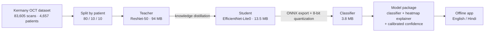
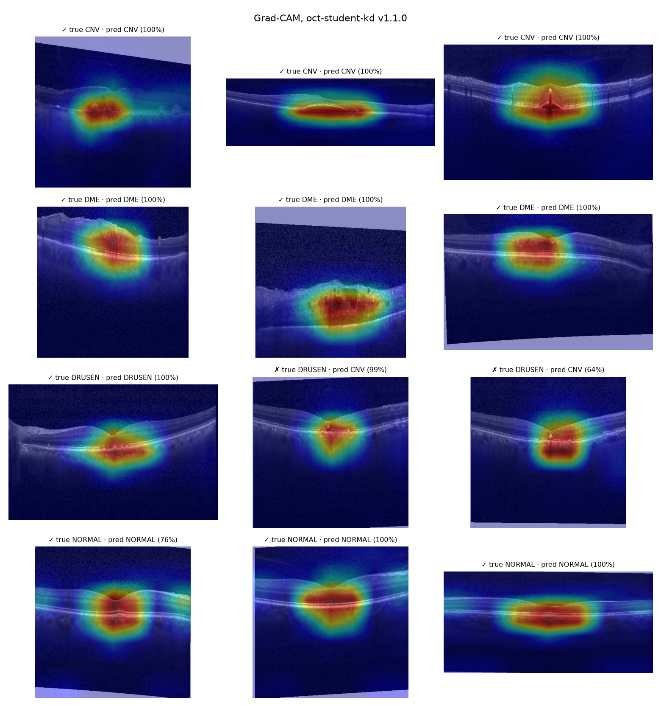

# Lightweight Retinal Disease Classification from OCT Scans using Knowledge Distillation and Quantization

**Accurate retinal OCT screening that runs on the hardware a small clinic already has: a CPU-only laptop, about 4 MB of model, no GPU and no internet.**

Team **MOTHERBOARD** · ZEISS BeyondCode'26 · Theme: *AI/ML for Advanced Frugal Innovation*

> ⚠️ **Screening aid, not a diagnosis.** It was evaluated on a public research dataset and is not clinically validated.

---

## Why this project exists

Retinal diseases show up early on **OCT scans**, but reading them takes a specialist. Most AI for this assumes a GPU, a cloud connection, or both. Many screening sites have neither.

**Our goal is frugal AI:** get the most diagnostic value out of the least compute. Instead of asking a clinic to buy better hardware, we make the model fit the hardware the clinic already has:

| Constraint | How we meet it |
|---|---|
| **No GPU** | Runs on CPU only, through ONNX Runtime |
| **Low-end CPU** (tested on a dual-core Intel i3-5005U with 6.4 GB RAM) | About 14 ms per scan |
| **Little memory and storage** | 3.80 MB model file; about 35 MB of extra RAM while running |
| **No internet** | Everything runs locally, with no cloud calls |
| **Needs to be trusted** | A heatmap of where the model looked, a calibrated confidence, and "send to a human" when it isn't sure |

**How we get there:**
- **Knowledge distillation:** a strong but heavy model (the *teacher*) trains a small one (the *student*).
- **Quantization:** the student is then stored in 8-bit integers instead of 32-bit floats.

The result keeps the teacher's accuracy at a fraction of the compute.

The model sorts an OCT scan into **4 classes**:

| Class | What it is | Triage |
|---|---|---|
| **CNV** | Choroidal neovascularization | 🔴 Urgent |
| **DME** | Diabetic macular edema | 🔴 Urgent |
| **DRUSEN** | Deposits under the retina (early AMD) | 🟡 Routine |
| **NORMAL** | Healthy retina | 🟢 Routine |

---

## Headline results

All results are on the **held-out test split: 7,818 scans from 462 patients** the model never saw. The test split was evaluated **once**, after every choice was frozen.

| | Teacher (ResNet-50) | **Our model (EfficientNet-Lite0, 8-bit)** |
|---|---|---|
| Model file size | 93.98 MB | **3.80 MB (24.7× smaller)** |
| Accuracy | 95.02% | **95.19%** |
| Macro-F1 (4 classes) | 92.46% | **92.79%** |
| Urgent cases caught (CNV + DME) | 96.29% | **96.85%** |
| Time per scan (CPU only, Intel i3-5005U) | 93.6 ms | **14.0 ms (6.7× faster)** |
| Extra RAM while running (process memory above baseline) | 139.0 MB | **34.5 MB** |

The student **matches** the teacher's accuracy with about a quarter of the memory and a seventh of the compute time. The accuracy differences are a few tenths of a point, within noise, so we don't claim it "beats" the teacher.

📄 Full table, method and per-class results: [`docs/benchmark.md`](docs/benchmark.md)

---

## How it works



1. **Split by patient, not by image.** One patient has many near-identical scans, so splitting by image leaks answers into the test set. A test ([`tests/test_split_no_leak.py`](tests/test_split_no_leak.py)) proves no patient appears in two splits.
2. **Teacher.** A large ResNet-50 learns the 4 classes. It was chosen over EfficientNet-B3 on validation macro-F1 (0.924 vs 0.891).
3. **Student.** A small EfficientNet-Lite0 learns to copy the teacher's soft answers (temperature 4, α = 0.7).
4. **Compress.** The student is exported to ONNX, then quantized to 8-bit integers (static QDQ, per-channel, reduce-range for older CPUs). 13.46 MB becomes 3.80 MB, with no accuracy loss.
5. **Explain.** Grad-CAM heatmaps come from the full-precision copy of the same student. It agrees with the 8-bit version on 99.5% of 400 test scans.
6. **Calibrate.** Temperature scaling on the validation set (T = 1.717) cut calibration error from **2.91% to 0.68%**, so a shown "90%" means about 90% right.

---

## Why you can trust the numbers

- **The test set was used once.** All tuning used the validation split.
- **Every number is measured.** Sizes are the files on disk. Latency is the median of 200 runs at batch 1, with the machine named.
- **Failures are reported too.** Our first student, **MobileNetV3-Small**, broke under 8-bit compression: it agreed with its own full-precision copy on only 27–41% of scans. The teacher's 8-bit copy agreed 100%, which proved the pipeline was fine and the architecture was the problem. We switched to **EfficientNet-Lite0**, which is designed for 8-bit, and it lost nothing. Details: [`docs/decisions.md`](docs/decisions.md)
- **Distillation is reported on both splits.** It added **+3.07 macro-F1 points on validation** but only **+0.61 on test**. We show both.

**It shows where it looked:** 12 real test scans with Grad-CAM heatmaps. The 2 mistakes are both DRUSEN read as CNV, which is the hardest pair to tell apart.



**It says when it isn't sure.** If every scan below a confidence cut-off goes to a human (validation set):

| Cut-off | Sent to a human | Accuracy on the rest | Urgent cases missed silently |
|---|---|---|---|
| 0.70 | 4.85% | 96.80% | 1.18% |
| 0.85 | 9.79% | 97.99% | 0.61% |
| 0.90 | 12.84% | 98.48% | 0.36% |

The full table is in [`docs/benchmark.md`](docs/benchmark.md), and the confusion matrix is in [`docs/img/confusion_test_kd_int8.png`](docs/img/confusion_test_kd_int8.png).

---

## Project status

| Part | Status |
|---|---|
| Data split by patient, data packs | ✅ Done |
| Teacher + student training (with distillation) | ✅ Done |
| ONNX export, 8-bit compression | ✅ Done (3.80 MB, no accuracy loss) |
| Grad-CAM heatmaps | ✅ Done |
| Calibration + review-threshold table | ✅ Done |
| Final test-set benchmark | ✅ Done (evaluated once) |
| Versioned model package for the app | ✅ Done (v1.1.1) |
| Bilingual offline app (Gradio, English / Hindi) | 🟡 In integration |
| Speed on our 2 other laptops (Ryzen 5, Core i5) | 🟡 In progress |
| Final submission | 📅 25 Nov 2026 |

---

## Quick start (Windows 10/11)

You need [uv](https://docs.astral.sh/uv/) and Git. uv installs the right Python version by itself.

```bash
git clone https://github.com/abirmazumdar03/oct-screening.git
cd oct-screening
uv sync --group optimize      # CPU-only PyTorch + ONNX Runtime
uv run pytest -q              # contract tests: split has no leak, preprocessing, ONNX parity, explainer
```

> **About model files and data:** model weights, ONNX files and data packs are **not in git**. They're too large, and the dataset has its own terms. The commands below expect them in `artifacts/`. The team shares them on Drive, or you can rebuild them yourself with the training steps further down.

### Run the shipped model

Expected locations:
- `artifacts/model_package/`: the model package
- `artifacts/packs/sample_scans/`: a few test images

```bash
# Heatmaps on 12 test scans → artifacts/benchmark/heatmap_gallery.png
uv run python -m octscreen.explain.gallery

# Speed on your machine: teacher vs our model
uv run python -m octscreen.optimize.benchmark latency --images artifacts/packs/sample_scans --machine my-laptop --models teacher.fp32 student_kd_lite0.int8

# Do the 8-bit and full-precision models agree?
uv run python -m octscreen.optimize.benchmark agree --a student_kd_lite0.fp32 --b student_kd_lite0.int8 --pack artifacts/packs/sample_scans
```

On Windows, Git Bash users should first run `export PYTHONUTF8=1`.

---

## Reproduce everything

### 1 · Training (Kaggle GPU; thin notebooks in `notebooks/kaggle/`)

```bash
uv sync --group train
uv run python -m octscreen.data.split                                    # → data/splits/splits_v1.csv
uv run python -m octscreen.data.export_packs --pack test                  # also: sample, calib, val
uv run python -m octscreen.training.train --config configs/teacher.yaml
uv run python -m octscreen.training.train --config configs/student_lite0.yaml      # student, no teacher
uv run python -m octscreen.training.train --config configs/student_kd_lite0.yaml   # student, with teacher
uv run python -m octscreen.training.evaluate --checkpoint artifacts/runs/student_kd_lite0_v1/best.pt --split val
```

The dataset location comes from the `OCT_DATA_ROOT` environment variable. The folder layout is discovered automatically.

### 2 · Compress, calibrate, benchmark, package (CPU laptop)

```bash
uv sync --group optimize
uv run python -m octscreen.optimize.export_onnx --model teacher student_base_lite0 student_kd_lite0
uv run python -m octscreen.optimize.quantize --model student_kd_lite0                      # → student_kd_lite0.int8.onnx

V="data.root=artifacts/packs/val_pack data.splits_csv=artifacts/packs/val_pack/manifest.csv"
uv run python -m octscreen.optimize.benchmark accuracy --split val --models student_kd_lite0.fp32 student_kd_lite0.int8 --set $V
uv run python -m octscreen.optimize.calibrate --model student_kd_lite0.int8 --set $V        # temperature + threshold table

M="teacher.fp32 student_base_lite0.fp32 student_kd_lite0.fp32 student_kd_lite0.int8"
uv run python -m octscreen.optimize.benchmark accuracy --split test --models $M --set data.root=artifacts/packs/test_pack data.splits_csv=artifacts/packs/test_pack/manifest.csv
uv run python -m octscreen.optimize.benchmark latency --images artifacts/packs/sample_scans --machine my-laptop --models $M
uv run python -m octscreen.optimize.benchmark report --split test                           # → artifacts/benchmark/benchmark.md
uv run python -m octscreen.optimize.package                                                  # → model package + zip + sha256
```

---

## Nothing is hard-coded

- **All settings live in YAML** under `configs/`. Any value can be overridden from the command line:
  ```bash
  uv run python -m octscreen.training.train --config configs/teacher.yaml --set train.epochs=3 train.batch_size=32
  ```
- **Paths come from environment variables** with defaults (`OCT_DATA_ROOT`, `OCT_CKPT_*`, `OCT_ONNX_DIR`), so the same config works on Kaggle, Colab and Windows.
- **Swapping a model is a config change, not a code change.** The MobileNetV3 → EfficientNet-Lite0 switch was one line: `model.arch`. The same goes for the quantization mode (`int8_static | int8_dynamic | fp16`).
- **Preprocessing is defined once** (`octscreen/common/preprocess.py`) and used by training, benchmarking and the app, so all three are identical by construction.

### The model package (what the app loads)

```
model_package/
├─ model_meta.json    # classes, preprocessing, precision, temperature, measured metrics
├─ classifier.onnx    # 8-bit classifier (3.80 MB)
├─ explainer.pt       # optional: full-precision weights for heatmaps
└─ README.txt
```

The app reads only `model_meta.json` to know what to do. Metrics stay `null` until they're measured; nothing is invented.

---

## Repository map

```
octscreen/
├─ common/      shared config loader, preprocessing, metrics, model-package schema
├─ data/        dataset discovery, patient-level split, data packs
├─ training/    models, distillation loss, training, evaluation
├─ optimize/    ONNX export, quantization, calibration, benchmark, packaging
└─ explain/     Grad-CAM explainer + heatmap gallery
configs/        all settings (data, teacher, students, optimize, app text in English/Hindi)
tests/          contract tests (no patient leak, preprocessing, ONNX parity, explainer, package schema)
docs/           benchmark, decisions log, training report, model card, heatmap gallery
data/splits/    the committed patient-level split (CSV + summary)
notebooks/      thin Kaggle runner notebooks
scripts/        PowerShell helpers (e.g. latency benchmark for teammates)
tools/          placeholder model package for app wiring tests
```

## Documentation

| Document | What's inside |
|---|---|
| [`docs/benchmark.md`](docs/benchmark.md) | Final results, compression check, calibration, threshold table, machines |
| [`docs/decisions.md`](docs/decisions.md) | Every decision with its reason, including what failed |
| [`docs/training_report.md`](docs/training_report.md) | Training runs, curves and validation metrics |
| [`docs/model_card.md`](docs/model_card.md) | Intended use, data, evaluation, limitations |
| [`data/splits/split_summary.json`](data/splits/split_summary.json) | Split counts per class and per patient |

---

## Limitations (stated openly)

- **One public dataset, mostly one scanner brand.** Performance on other scanners, including ZEISS devices, is untested.
- **Not comparable to published 96–99% results.** Those use an image-level split; ours is the stricter patient-level split.
- **DRUSEN is the hardest class** (88% recall on test). It's mostly confused with CNV.
- **8-bit made the model smaller, not faster, on our test CPU (i3-5005U).** That CPU lacks fast 8-bit (VNNI) instructions, so the speed gain comes from the smaller network. Newer CPUs with VNNI may also run the 8-bit model faster; we haven't measured that yet.
- **A screening aid on research data.** It doesn't diagnose and isn't clinically validated.

## Team

| Member | Role |
|---|---|
| **Aditya Kumar** | Data pipeline, patient-level split, teacher and student training |
| **Abir Mazumdar** | Compression, explainability (Grad-CAM), calibration, evaluation, shared baseplate |
| **Soumya Deep Poddar** | Offline bilingual app, input safety, triage, deployment |

## Data and citation

Kermany, D. S., et al. *Identifying Medical Diagnoses and Treatable Diseases by Image-Based Deep Learning.* **Cell** 172(5), 2018. Dataset: "Labeled Optical Coherence Tomography (OCT) and Chest X-Ray Images for Classification", Mendeley Data.