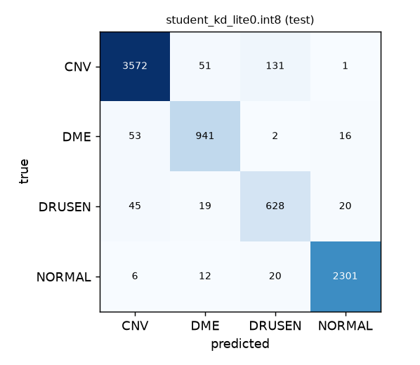

# Benchmark

Every number on this page was measured by `octscreen.optimize.benchmark` and `octscreen.optimize.calibrate`. The raw outputs are in `artifacts/benchmark/` (`benchmark.json`, `accuracy_test.json`, `accuracy_val.json`, `calibration.json`, `latency_abir-i3.json`).

- **Test split:** 7,818 images from 462 patients. Evaluated **once**, after every choice was frozen.
- **Val split:** 7,980 images from 460 patients. Used for every decision: compression check, calibration and threshold table.
- **Split:** by patient (80/10/10, seed 42). No patient appears in two splits.
- **Dataset:** Kermany et al., *Cell* 2018. This is public research data, mostly from one OCT scanner brand.

---

## 1. Final results (test split, evaluated once)

| Model | Precision | Size (MB) | × smaller | Accuracy | Macro-F1 | Urgent sensitivity | p50 latency (ms), abir-i3 |
|---|---|---|---|---|---|---|---|
| Teacher: ResNet-50 | FP32 | 93.98 | 1.0× | 95.02% | 92.46% | 96.29% | 93.6 |
| Student: EfficientNet-Lite0, no teacher | FP32 | 13.46 | 7.0× | 94.61% | 91.96% | 96.16% | 12.8 |
| Student: EfficientNet-Lite0, distilled (KD) | FP32 | 13.46 | 7.0× | 95.02% | 92.57% | 96.58% | 14.5 |
| **Student: EfficientNet-Lite0, KD, INT8 (shipped)** | **INT8** | **3.80** | **24.7×** | **95.19%** | **92.79%** | **96.85%** | **14.0** |

**Column definitions**
- **Size:** the `.onnx` file on disk (MB = 10⁶ bytes).
- **× smaller:** teacher file size ÷ model file size, both measured.
- **Urgent sensitivity:** the share of truly urgent scans (CNV or DME) that the model predicts as an urgent class.
- **Latency:** batch 1, 20 warm-up runs, then the median of 200 runs. It counts model inference only, through ONNX Runtime on the CPU. End-to-end time including preprocessing is in `benchmark.json`.

---

## 2. The frugal story in numbers

- **Size: 93.98 MB → 3.80 MB (24.7× smaller).** That's the measured teacher FP32 file against the shipped INT8 student file.
- **Accuracy: no loss against the teacher.** The shipped model scores 92.79% macro-F1 against the teacher's 92.46%, and 96.85% urgent sensitivity against 96.29%. These differences are a few tenths of a point, which is within run-to-run noise on ~7.8k images. The fair statement is "matches the teacher", not "beats it".
- **Speed: 93.6 ms → 14.0 ms per scan (6.7× faster)** on a 2015-era Core i3 laptop with no GPU.
- **The INT8 gain is size, not speed, on this CPU.** All three Lite0 models are the same network, and their latencies (12.8–14.5 ms) differ by run-to-run variation. The i3-5005U has no VNNI 8-bit instructions, so INT8 isn't expected to be faster there. We don't claim a speed-up from INT8.

---

## 3. What each step contributed

### 3.1 Distillation (the teacher's help)

| Split | No teacher, macro-F1 | With teacher (KD), macro-F1 | Gain |
|---|---|---|---|
| Val (7,980 images) | 88.81% | 91.88% | **+3.07 points** |
| Test (7,818 images) | 91.96% | 92.57% | **+0.61 points** |

KD helped on both splits, but the gain on test (+0.6) is much smaller than on val (+3.1). Both numbers are reported. The test gain is small enough that it may be partly noise.

### 3.2 Compression (FP32 → INT8), measured on val before choosing

| Model | Accuracy | Macro-F1 | Urgent sensitivity |
|---|---|---|---|
| KD student FP32 | 94.92% | 91.88% | 97.70% |
| KD student INT8 | 95.01% | 91.95% | 97.89% |

- **Change in macro-F1: +0.07 points.** The target was a drop of no more than 2 points. INT8 caused no measurable accuracy loss. The tiny gain is noise, not an improvement.
- **On test:** 92.57% (FP32) → 92.79% (INT8), consistent with val.
- **Agreement on the i3:** the INT8 and FP32 models give the same prediction on **99.5%** of images (`benchmark agree`, run on abir-i3).
- **Earlier failure, recorded honestly:** the first student, MobileNetV3-Small, broke under INT8. It agreed with its own FP32 version on only 27–41% of images. The teacher's INT8 version agreed 100%, which showed the pipeline was fine and the problem was that architecture. We therefore switched the student to EfficientNet-Lite0 (see `docs/decisions.md`).

---

## 4. Where the model makes mistakes

Per-class results for the shipped INT8 model on **val**:

| True class | Images | Recall | Precision | Most common mistake |
|---|---|---|---|---|
| CNV (urgent) | 4,053 | 95.95% | 97.30% | → DRUSEN (82), → DME (79) |
| DME (urgent) | 688 | 94.48% | 85.87% | → CNV (23), → NORMAL (14) |
| DRUSEN | 792 | 82.95% | 84.56% | → CNV (81), → NORMAL (46) |
| NORMAL | 2,447 | 97.51% | 97.43% | → DRUSEN (37), → DME (20) |

- **DRUSEN is the weakest class (83% recall).** It's confused with CNV in both directions. Both are stages of age-related macular degeneration and can look alike on a single B-scan.
- **The most important error is CNV predicted as DRUSEN** (82 of 4,053 CNV scans, about 2%). This is the main way an urgent case can be marked non-urgent. The confidence threshold in §5 is the safeguard.
- **Urgent scans called NORMAL are rare:** 3 CNV and 14 DME out of 4,741 urgent val scans.

---

## 5. Confidence calibration and the "uncertain" threshold (val)

Temperature scaling was fitted on val only, never on test.

| | Before | After (T = 1.717) |
|---|---|---|
| Expected calibration error (ECE) | 2.91% | **0.68%** |
| Negative log-likelihood | 0.174 | 0.141 |

- **T > 1 means the raw model was slightly over-confident.** After calibration, a displayed confidence of 90% corresponds to about 90% accuracy on val.
- **Accuracy is unchanged:** calibration rescales the probabilities only.
- **T is stored in `model_meta.json`,** and the app applies it before showing any confidence.

**Threshold table:** what happens if the app flags every scan below a given confidence as "uncertain: refer for manual review" (shipped INT8 model, calibrated, val):

| Threshold | Flagged uncertain | Accuracy on the rest | Silent urgent misses |
|---|---|---|---|
| 0.50 | 0.44% | 95.25% | 2.046% |
| 0.60 | 2.64% | 96.02% | 1.603% |
| 0.70 | 4.85% | 96.80% | 1.181% |
| 0.80 | 7.81% | 97.63% | 0.844% |
| 0.85 | 9.79% | 97.99% | 0.612% |
| 0.90 | 12.84% | 98.48% | 0.359% |
| 0.95 | 19.20% | 99.16% | 0.084% |

**Silent urgent misses** are truly urgent scans (CNV or DME) that are *not* flagged uncertain *and* are predicted as non-urgent, as a percentage of all urgent scans. These are the dangerous cases. A higher threshold sends more scans to manual review and lets fewer urgent cases through silently. The app's threshold is app policy, chosen by the app owner from this table and recorded in `docs/decisions.md`.

---

## 6. Machines

| Machine | CPU | Cores (phys/log) | RAM | On battery | ONNX Runtime |
|---|---|---|---|---|---|
| abir-i3 | Intel Core i3-5005U @ 2.00 GHz (2015) | 2 / 4 | 6.4 GB | no | 1.31.1 |

Latency on the team's other two laptops (Ryzen 5 and i5) is added when measured (`scripts/bench_latency.ps1`). The package always reports the **slowest** measured machine.

---

## 7. Limits of these numbers

- **One public dataset, mostly one scanner brand.** Performance on other scanners, including ZEISS devices, is untested.
- **Not comparable to published 96–99% figures.** Those use the dataset's official small test set, which isn't split by patient. Our patient-level split is stricter.
- **Heatmaps come from the FP32 version** of the same student network. The shipped classifier is INT8, and the two agree on 99.5% of images.
- **Calibration was fitted on val from the same dataset,** so it may not hold on images from other scanners.
- **This is a screening aid evaluated on research data.** It isn't clinically validated and doesn't diagnose.